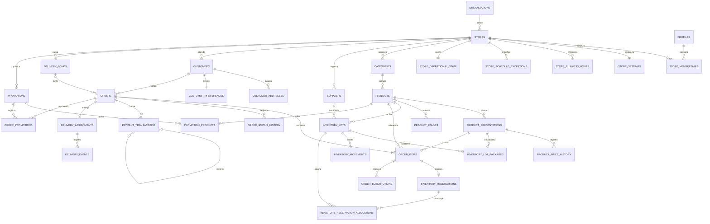
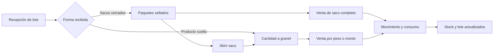
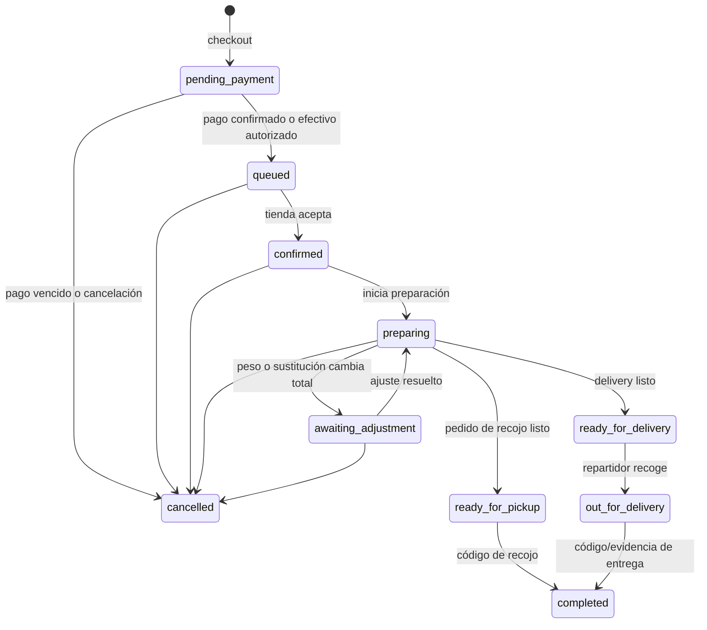
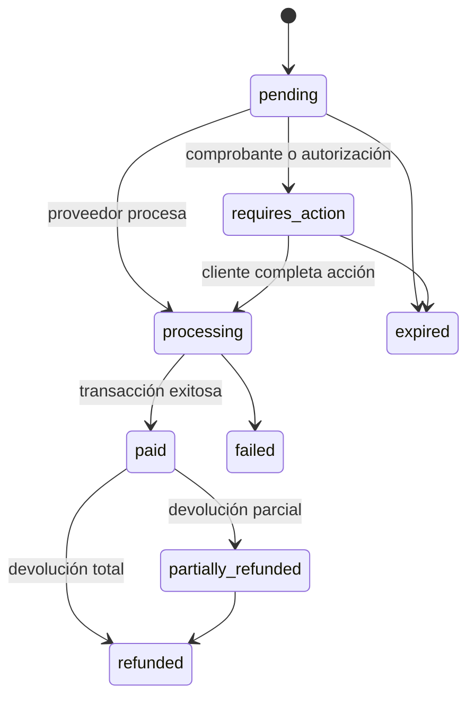

# Modelo de datos v2 — Cogana

Fecha: 17 de septiembre de 2026  
Estado: diseño objetivo del MVP completado  
Esquema SQL asociado: `database/cogana_v2_target_schema.sql`

## 1. Objetivo

Este modelo está diseñado para la primera tienda Cogana en Santa Anita y mantiene aislamiento por tienda para permitir futuras marcas independientes. Cubre catálogo, venta por unidad/peso/monto/saco, lotes y vencimientos, pedidos como invitado, pagos, recojo, delivery propio, sustituciones, promociones y horarios flexibles.

No incluye caja, POS, asistencia, planillas, comercio B2B, facturación electrónica automática, operadores logísticos externos ni sincronización fuera de línea.

## 2. Decisiones estructurales

1. **Una tienda es una frontera de datos.** Toda entidad operativa contiene `store_id` y las relaciones importantes incluyen ese identificador para impedir cruces entre marcas.
2. **El dinero se almacena en céntimos.** S/ 4.10 se guarda como `410`, nunca como un número de punto flotante.
3. **El inventario usa unidades enteras mínimas.** Gramos, unidades o mililitros; no se almacenan cantidades decimales.
4. **Los precios pertenecen a presentaciones.** Un producto puede venderse simultáneamente a granel, por monto libre y como saco cerrado con otro precio.
5. **Los lotes son la fuente del stock.** No se duplica un stock editable en `products`.
6. **Las reservas se asignan a lotes.** Esto permite FEFO, vencimiento, liberación y trazabilidad.
7. **El pedido y el pago tienen estados separados.** Un error o devolución de pago no altera de forma ambigua el avance físico del pedido.
8. **El comprador invitado usa una identidad anónima de Supabase.** No ve un registro obligatorio y luego puede convertir la sesión en una cuenta permanente.
9. **Las operaciones críticas pasan por servidor.** Checkout, reservas, cambios de estado, cobros, reembolsos y consumo de stock deben ejecutarse mediante Edge Functions y transacciones privadas.
10. **Los reportes se calculan desde pedidos, pagos e inventario.** No se crean tablas duplicadas de “ventas”.

## 3. Diagrama entidad–relación

El diagrama muestra las relaciones principales. Las tablas de historial y eventos conservan la auditoría sin convertirse en una segunda fuente de verdad.

## 4. Catálogo de tablas

El modelo objetivo contiene 35 tablas.

| Bloque | Tablas | Responsabilidad |
|---|---|---|
| Organización | `organizations`, `stores` | Marca/empresa y tienda aislada. |
| Usuarios internos | `profiles`, `store_memberships` | Propietario, administrador y repartidor. |
| Operación | `store_settings`, `store_business_hours`, `store_schedule_exceptions`, `store_operational_state` | Configuración, horario normal, excepciones y apertura/pausa real. |
| Catálogo | `categories`, `products`, `product_presentations`, `product_images`, `product_price_history` | Producto y todas sus formas de venta. |
| Inventario | `suppliers`, `inventory_lots`, `inventory_lot_packages`, `inventory_movements` | Lotes, vencimiento, sacos sellados, granel y auditoría. |
| Clientes | `customers`, `customer_addresses`, `customer_preferences` | Invitados, cuentas, direcciones y consentimientos. |
| Cobertura | `delivery_zones` | Santa Anita inicialmente, con tarifa y tiempo estimado. |
| Pedidos | `orders`, `order_items`, `order_status_history`, `order_substitutions` | Solicitud, preparación, cambios y sustituciones. |
| Reservas | `inventory_reservations`, `inventory_reservation_allocations` | Bloqueo temporal y asignación FEFO por lote. |
| Pagos | `payment_transactions`, `payment_events` | Intentos, cobros, ajustes, devoluciones y webhooks idempotentes. |
| Reparto | `delivery_assignments`, `delivery_events` | Repartidor propio, recorrido e incidencias. |
| Marketing | `promotions`, `promotion_products`, `order_promotions` | Reglas, productos participantes y descuentos aplicados al pedido. |
| Privacidad | `account_deletion_requests` | Solicitud y trazabilidad de eliminación de cuenta. |

## 5. Producto, presentación y precio

`products` describe el artículo: “Arroz Popeye Verde”. `product_presentations` describe cómo puede comprarse.

Ejemplo de configuración:

| Presentación | Tipo | Cantidad base | Precio | Entrada permitida | Sellado |
|---|---:|---:|---:|---|---|
| A granel | `bulk` | 1,000 g | S/ 4.00 | gramos y monto en soles | No |
| Saco 50 kg | `sack` | 50,000 g | S/ 183.00 | una o más presentaciones | Sí |

Cuando el precio a granel cambie de S/ 4.00 a S/ 4.10 sólo se actualiza esa presentación y se registra el cambio en `product_price_history`. El precio del saco puede cambiar de forma independiente.

### Modos de solicitud

- `quantity`: el cliente escribe gramos, unidades o mililitros.
- `money`: el cliente escribe, por ejemplo, S/ 3.00.
- `presentation`: el cliente compra un paquete, caja o saco completo.

`order_items` guarda tanto lo solicitado como la cantidad estimada y la finalmente preparada. Así nunca se pierde la intención original del cliente.

### Reglas de cálculo

- Precio proporcional: `cantidad × precio / cantidad_de_precio`.
- Cuando el cliente escribe dinero, la cantidad estimada se redondea hacia abajo al paso permitido para no superar el monto solicitado.
- El total mostrado se redondea al céntimo más cercano.
- Para productos pesados, el pedido conserva total estimado y total final.
- Una diferencia positiva posterior al pesaje requiere autorización/cobro; una diferencia negativa genera ajuste o devolución.

## 6. Inventario, sacos y FEFO

Reglas obligatorias:

1. Cada entrada crea o incrementa un lote.
2. Un lote vencido o bloqueado no se ofrece ni se reserva.
3. Para granel, se asigna primero el lote disponible con vencimiento más próximo; los lotes sin fecha quedan al final.
4. Un saco completo sólo puede reservarse si existe una unidad sellada.
5. Abrir un saco es un movimiento de inventario con cambio neto cero: disminuye una unidad sellada y aumenta el granel.
6. La preparación consume las asignaciones del pedido; la cancelación las libera.
7. Una reserva no pagada expira automáticamente.
8. Los movimientos son inmutables; una corrección se registra con otro movimiento.

## 7. Estados del pedido

Reglas:

- Los pedidos creados fuera de horario pueden pagarse y quedar en `queued`.
- `preparation_not_before` indica cuándo pueden empezar a prepararse.
- La cola empieza a correr cuando la tienda cambia a `preparing_orders` y llega la hora correspondiente.
- Cada transición genera una fila en `order_status_history` con `operation_id` único.
- `completed` y `cancelled` son finales.
- Un no-show de efectivo se registra como cancelación con código `customer_no_show`; futuras restricciones deben ser explícitas y visibles.

## 8. Estados del pago

Correspondencia técnica:

- `orders.payment_status` es el resumen actual para la interfaz.
- `payment_transactions` es el libro de movimientos: cargo, ajuste o devolución.
- `payment_events` guarda cada evento único del proveedor y evita procesar dos veces un webhook.
- Yape/Plin pueden empezar con comprobante y verificación manual.
- Tarjeta debe procesarse con un proveedor certificado; Cogana no guarda PAN, CVV ni credenciales.
- Efectivo sólo se acepta cuando `fulfillment_type = pickup`.

## 9. Sustituciones

Cada ítem guarda una política:

- `allow_similar`: Cogana puede sustituir dentro del aumento máximo autorizado.
- `contact`: se crea una propuesta y se espera respuesta.
- `remove`: si falta, se elimina y se ajusta el pago.

Una propuesta contiene producto/presentación sustituta, cantidad, total, diferencia y vencimiento. Si aumenta el total más allá del límite autorizado, el pedido pasa a `awaiting_adjustment`. Si disminuye, se registra un ajuste o devolución.

## 10. Horarios y disponibilidad

El horario deja de ser texto libre:

- `store_business_hours`: horario habitual por día de semana.
- `store_schedule_exceptions`: cierre temprano, feriado o apertura especial por fecha.
- `store_operational_state`: decisión real del dueño ese día.

La tienda puede estar:

- `closed`: no se prepara, pero se pueden recibir pedidos programados;
- `accepting_orders`: acepta pedidos futuros, sin afirmar que ya se preparan;
- `preparing_orders`: la preparación está activa;
- `paused`: pausa temporal con mensaje y posible hora de retorno.

## 11. Promociones del MVP

Tipos admitidos:

- porcentaje de descuento;
- descuento fijo;
- precio fijo promocional;
- precio por cantidad;
- delivery gratis.

`promotion_products` permite aplicar una promoción a todo un producto o sólo a una presentación. Las promociones tienen prioridad, límites y la opción de combinarse; por defecto no se combinan.

## 12. Acceso y seguridad

| Actor | Puede leer | Puede modificar |
|---|---|---|
| Visitante | Catálogo público sanitizado mediante Edge Function | Nada |
| Invitado con sesión anónima | Sus datos, pedidos, pagos y seguimiento | Perfil/direcciones propias; checkout mediante servidor |
| Cliente registrado | Lo mismo que el invitado, recuperable en otros dispositivos | Preferencias y cuenta propia |
| Propietario/admin | Datos completos de su tienda | Catálogo/configuración directa; operaciones críticas mediante servidor |
| Repartidor | Entregas asignadas y datos mínimos del destinatario | Eventos de su entrega mediante servidor |
| Proveedor de pago | Nada por Data API | Webhook firmado mediante Edge Function |

Principios aplicados:

- RLS en las 35 tablas.
- Ningún acceso directo para `anon` a las tablas.
- Uso de `(select auth.uid())` en políticas.
- Funciones privilegiadas en `private`, no en `public`.
- Permisos explícitos y mínimos.
- El `service_role` sólo vive en servidor.
- Las imágenes de producto pueden ser públicas; evidencias y comprobantes deben ser privados.

## 13. Operaciones transaccionales que deben implementarse

El esquema está listo, pero estas operaciones deben escribirse como migraciones/funciones y probarse antes del frontend:

1. `create_checkout_order`: valida precios, horario, zona, cliente, método y reserva stock.
2. `reserve_inventory_fefo`: asigna lotes de manera atómica y ordenada.
3. `release_expired_reservations`: libera pedidos impagos vencidos.
4. `open_inventory_package`: transforma saco sellado en granel sin alterar el total.
5. `transition_order`: aplica únicamente transiciones permitidas e idempotentes.
6. `record_payment_event`: procesa webhooks una sola vez.
7. `finalize_weighted_order`: calcula peso final y diferencia de pago.
8. `propose_substitution` y `decide_substitution`.
9. `complete_pickup` y `complete_delivery`: validan código/evidencia.

Las filas de producto/lote se bloquean siempre en un orden estable para evitar sobreventa y bloqueos cruzados. Ninguna llamada externa al proveedor de pagos debe hacerse mientras una transacción de base mantiene bloqueos.

## 14. Tratamiento de la base anterior

El archivo SQL representa el destino, no debe ejecutarse directamente sobre Solaris porque ya existen tablas con esos nombres.

La migración real se dividirá así:

1. respaldo y tipos actuales;
2. columnas y tablas nuevas;
3. migración de los datos de prueba útiles;
4. funciones transaccionales nuevas;
5. políticas RLS nuevas;
6. pruebas de aislamiento y concurrencia;
7. desactivación de módulos antiguos;
8. eliminación posterior, nunca en la misma primera migración.

## 15. Criterios para considerar terminado el backend de datos

- Compra anónima y conversión a cuenta probadas.
- Saco completo, peso libre y monto libre probados con redondeos.
- Dos compradores no pueden reservar el mismo último stock.
- FEFO selecciona el lote correcto y bloquea vencidos.
- Reservas impagas expiran y liberan inventario.
- Efectivo para delivery es rechazado por base/servidor.
- Webhook duplicado no duplica el cobro.
- Sustitución y diferencia de precio quedan auditadas.
- Propietario y repartidor sólo acceden a su tienda/asignación.
- Los asesores de Supabase no reportan funciones privilegiadas expuestas.

Con estas reglas, el diseño de datos queda cerrado para iniciar las migraciones de implementación.
